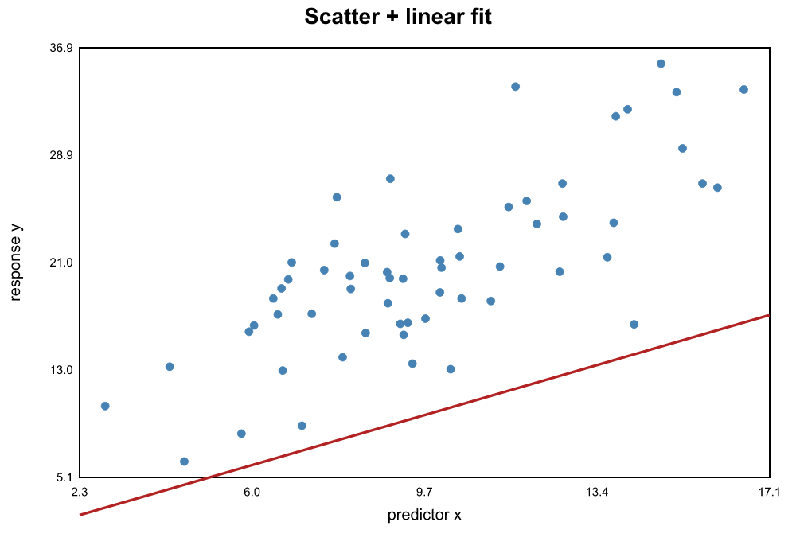
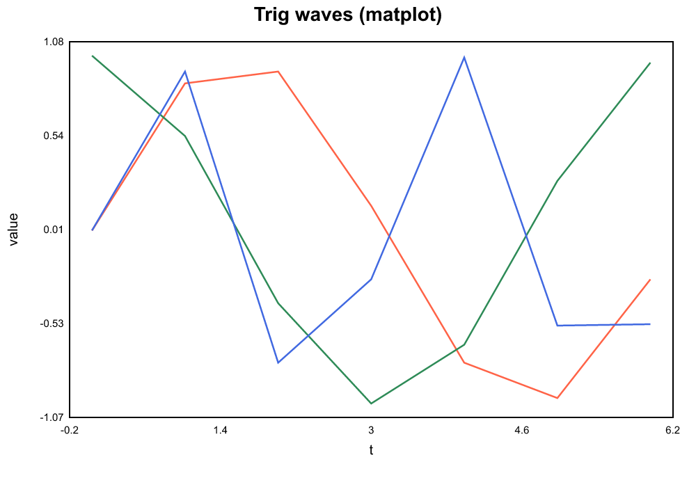
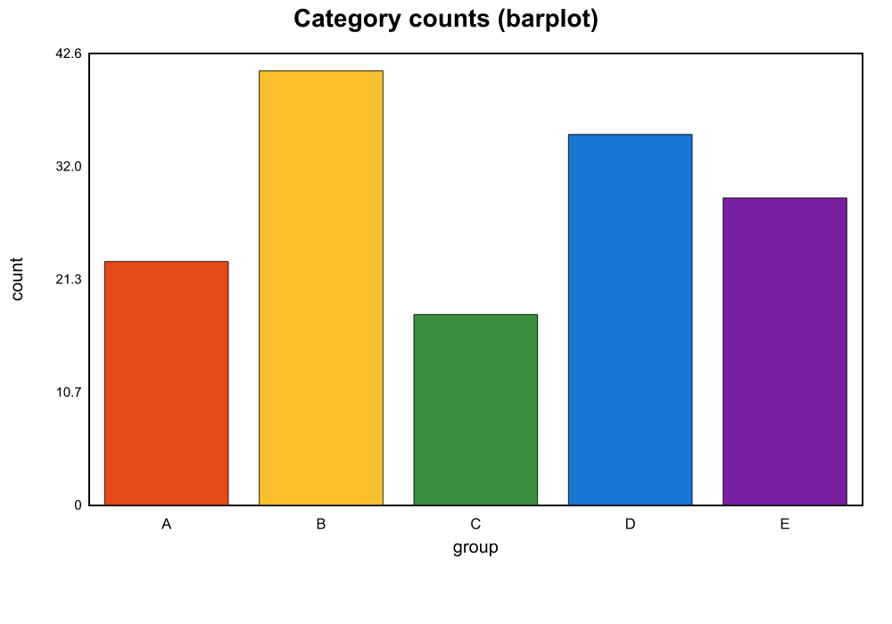
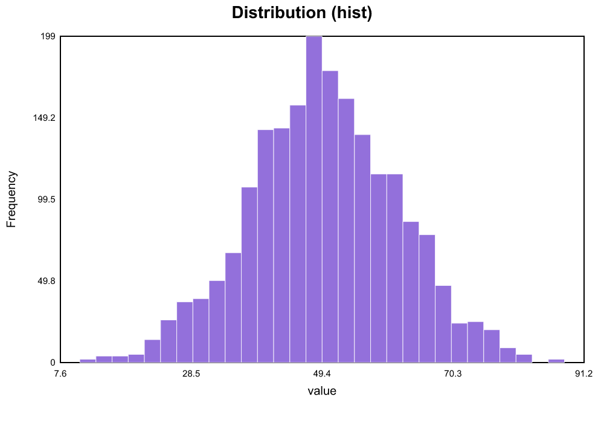
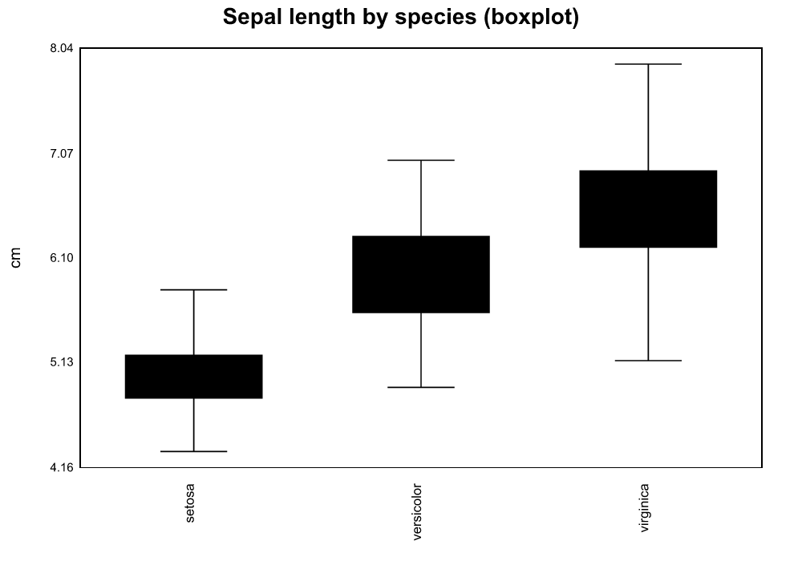
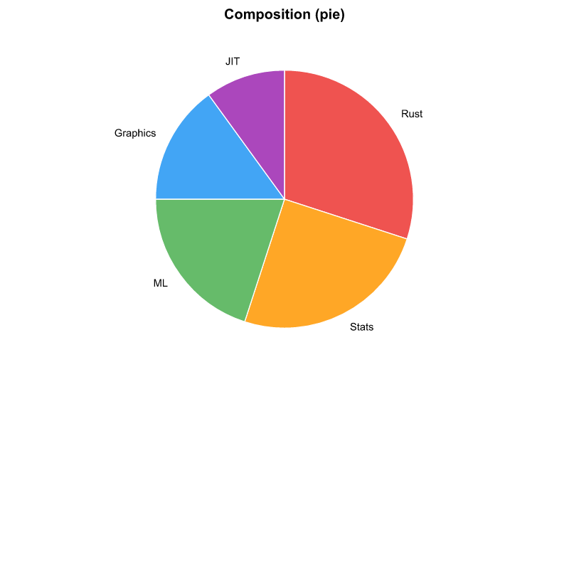

<p align="center">
  
</p>

<h1 align="center">Ardon-R2</h1>

<p align="center"><strong>Statistics and language-model training, in one small Rust binary.</strong><br>
<em>Inspired by R. Built on Rust. An AI-Assisted Project.</em><br>
<a href="https://github.com/devendratandle/Ardon-R2/releases/latest"></a></p>

---

**Ardon-R2 is a ground-up, pure-Rust reimplementation of both a statistical
runtime and an LLM training stack.** For statistics, it keeps R's syntax and
overcomes R's best-known limits: it uses all your cores automatically and
analyzes datasets larger than RAM, with results that agree with R to 15–16
significant figures. For AI, it trains small language models (SLMs) on a
student's laptop CPU and gives professionals a complete language-model training
pipeline, from tokenizer to fine-tuning, with results that match PyTorch.
Underneath are a Cranelift JIT, automatic parallelism chosen by the Oracle
scheduler, memory-mapped out-of-core data and Arrow-style columnar memory, in one
small binary with no C, C++, Fortran or Python.

| Desktop GUI (`R2Gui`) | Console (`r2`) |
|---|---|
|  |  |

## Quick start

**Prebuilt:** Windows installer from the
[releases page](https://github.com/devendratandle/Ardon-R2/releases/latest) (about
9 MB, CLI + GUI + docs + samples); Linux in [INSTALL_LINUX.md](INSTALL_LINUX.md).

**From source**, with a recent stable Rust (1.82 or later):

```bash
cargo build --release
./target/release/r2                                 # REPL (Windows: .\target\release\r2.exe)
./target/release/r2 samples/smoke.r                 # the same script runs on R; compare the output
./target/release/r2 samples/llm/train_1m.r2         # train a small language model
```

## Statistics, in R's language

R2 speaks R's syntax, and your loops compile to native code:

```r
d <- data.frame(score = c(81.5, 77, 92.25, NA, 68, 88), group = factor(c("a", "b", "a", "b", "a", "b")))
t.test(score ~ group, data = d)
fit <- lm(score ~ group, data = d)
summary(fit)
hist(d$score, plot = FALSE)$counts
```

| Compared with R 4.5.3 (reference BLAS) | R2 |
|---|---|
| Accuracy | **agrees to 15–16 significant figures**, 42/42 differential cases |
| R's own C internals (`sum`, `sort`, `sd`, `cor`) | about level: ahead on `sum`, behind on `cor` |
| Matrix multiply | **11–25× faster** |
| LU, Cholesky, eigen, SVD at n = 1000 | **2–6× faster** |
| Your own loops and library code | **6–40,000× faster**, JIT-compiled |

The large matrix gaps are because stock R ships a single-threaded reference BLAS;
against R on OpenBLAS or MKL they would be far smaller. Timings and method are in
[`PERFORMANCE.md`](PERFORMANCE.md).

**Data larger than RAM.** Columns live on disk and are memory-mapped, so an
analysis costs a window of RAM rather than the size of the data:

```r
cols <- mmap.csv("big.csv")                       # stream the file into mapped columns
fit <- mmap.lm(cols, "y", c("x1", "x2"))          # least squares in one streaming pass
```

**Also built in:**

- **534 built-in functions and operators**, every one with `?help`.
- **Statistics:** `lm`/`glm`/`aov` (including repeated-measures `Error()`),
  `t.test`, `cor.test`, `chisq.test`, `shapiro.test`, Hotelling's T², MANOVA.
- **Machine learning:** decision tree, random forest, gradient boosting, KNN,
  naive Bayes, PCA, K-means, cross-validation.
- **Graphics:** scatter, line, bar, histogram, box and pie plots, `par()`
  layouts, PNG/SVG/PDF output and a live browser viewer.
- **A desktop GUI** (`R2Gui`), and `r2 --ide` as the engine for separate editors
  ([protocol](docs/IDE_PROTOCOL.md)).

Plots from [`samples/graph_gallery.r2`](samples/graph_gallery.r2):

| | | |
|---|---|---|
|  |  |  |
|  |  |  |

### Coming from R

R2 is **not yet a drop-in replacement for R**. Most everyday scripts run, but:

- **No CRAN packages.** `ggplot2`, `dplyr` and the rest do not run here. R2 has its
  own package system for packages written in R2.
- **Still missing:** `lmer` random effects and the non-central
  distributions. `aov` handles one factor, with or without `Error()`.
- **Evaluation differs in places:** arguments are evaluated eagerly (no lazy
  promises), and a printed `summary(fit)` or ANOVA table is laid out differently
  from R's, though the values match.

Run your own script and tell us what breaks: every report helps. The full list,
with targets, is in [`docs/KNOWN_LIMITATIONS.md`](docs/KNOWN_LIMITATIONS.md).

## Language-model training

The whole pipeline from raw text to a served model, in the same language:

```r
m <- llm.new(dim = 128, layers = 4, heads = 4, kv.heads = 2, ffn = 384,
             vocab = 2000, ctx = 64, lr = 0.001)

llm.train(m, "stories.txt", steps = 2000, seq = 64, batch = 16, shuffle = TRUE,
          wd = 0.01, clip = 1, schedule = "cosine", warmup = 100,
          checkpoint = "run1", every = 500, report = 100)

llm.generate(m, "Once upon a time", n = 40, temperature = 0.8, top.k = 40)
llm.save(m, "mymodel")        # model.json + model.safetensors + tokenizer.json
```

A run that stopped carries on from its checkpoint, bit for bit:

```r
m <- llm.resume("run1")
```

### Fine-tuning

Teach a saved model new answers through LoRA adapters. Only the adapters train,
so the base model stays untouched and the result is a small file:

```r
m <- llm.load("mymodel", train = TRUE, lr = 0.001)
llm.lora(m, rank = 8, alpha = 16)        # freeze the model, add adapters

llm.finetune(m, prompts = c("capital of france:", "capital of japan:"),
             completions = c(" paris.", " tokyo."),
             steps = 300, batch = 2, seq = 32)

llm.save.adapter(m, "my-adapter")        # the small file; applies to this base only
llm.save(m, "merged")                    # or a whole model with the adapters merged in
```

Full recipes: [`samples/llm/train_1m.r2`](samples/llm/train_1m.r2),
[`samples/llm/finetune.r2`](samples/llm/finetune.r2) and
[`samples/llm/deploy.r2`](samples/llm/deploy.r2).

### How it compares with PyTorch

Same model, same tokens, same starting weights, run one after the other on the
same machine.

| Test | Model | Hardware | Opponent | R2 trains | Result |
|---|---|---|---:|---:|---|
| Standard | 7.24M | AMD Ryzen 5 4500U, CPU | PyTorch + MKL | **1.45–1.90× faster** | same loss, 4 decimals |
| Standard | 39.8M | AMD Ryzen 5 4500U, CPU | PyTorch + MKL | **1.40–1.63× faster** | same loss |
| Standard | 7.24M | Intel i5-12500, CPU | PyTorch + MKL | **1.34–1.37× faster** | same loss |
| Whole step on the GPU | 7.24M | AMD Radeon integrated | PyTorch-DirectML | **1.34–1.37× faster** | same loss |
| Whole step on the GPU | 39.8M | AMD Radeon integrated | PyTorch-DirectML | **1.5–2.0× faster** | same loss |
| Complete, 8 epochs | 1.30M | AMD Ryzen 5 4500U, CPU | PyTorch + MKL | **1.22× faster** | held-out 2.768 vs 2.785 |

BPE tokenization is about **10× faster than HuggingFace `tokenizers`**.

**How to read these:**

- **"Same loss" holds for hundreds of steps, not forever.** Over a long run the
  two engines' f32 rounding differs and their losses drift apart slowly: over
  10,500 steps they ended 0.62% apart. That is a tie, not a win for either side.
- **R2's lead depends on the model.** It is largest around 7M and smaller on very
  small models.
- **The largest model measured is 39.8M, on one machine.** Nothing here measures
  a discrete GPU: against PyTorch with CUDA on a dedicated card, expect a different
  picture. That comparison has not been run.

Every figure, the command that reproduces it, and the approaches that were
measured and did *not* help are in
[`benchmarks/llm/REPORT.md`](benchmarks/llm/REPORT.md), the single source for
these numbers. To run the small complete test yourself:
[`benchmarks/llm/small_vs_pytorch.sh`](benchmarks/llm/small_vs_pytorch.sh).

### What's in the pipeline

| Stage | What R2 has |
|---|---|
| **Tokenizer** | Byte-level BPE, learned from your text; reads and writes HuggingFace `tokenizer.json` |
| **Data** | Tokens memory-mapped from disk in the training harness; seeded shuffling that stores nothing; prompt-and-completion examples with padding |
| **Model** | Llama-family transformer: RMSNorm, RoPE, grouped-query attention, SwiGLU |
| **Gradients** | Reverse-mode autograd tape with fused attention and hand-written AVX2 kernels, chosen at runtime |
| **Optimizer** | Adam and AdamW, warmup + cosine schedule, gradient clipping, gradient accumulation |
| **Runs** | Checkpoints written without copying the model; a resumed run is bit-identical to an uninterrupted one |
| **Fine-tuning** | LoRA adapters, frozen layers, targets excluded from the loss (`ignore_index`) |
| **GPU** | The whole step on any Vulkan/DX12/Metal device via wgpu, including integrated ones; mixed precision and activation checkpointing |
| **Serving** | safetensors weights, KV cache, temperature and top-k sampling |

### What it does not do yet

- **No end-of-text token:** generation runs for the `n` you ask for, past a learned answer.
- **One machine:** multi-machine training exists only as a tested design, not a product.
- **GPU gaps:** LoRA, frozen layers and accumulation are CPU only, and the shipped
  binary is CPU only (`device = "gpu"` needs a `--features gpu` build).
- **Bigger than RAM has limits here:** `llm.train` holds its tokens in RAM, and a model
  larger than RAM cannot be served yet.
- **Fine-tuning starts from models trained in R2.** There is no importer for other
  projects' weights, by design.

## Find your way around

| Path | What's there |
|---|---|
| [`PERFORMANCE.md`](PERFORMANCE.md) | **R2 vs R**: speed and accuracy |
| [`benchmarks/llm/REPORT.md`](benchmarks/llm/REPORT.md) | **R2 vs PyTorch and JAX**: every LLM figure with its command, and what was tried and failed |
| [`benchmarks/`](benchmarks) | The harnesses behind both reports |
| [`samples/`](samples) | Programs to run. Found a mismatch with R? [Open an issue](https://github.com/devendratandle/Ardon-R2/issues) |
| [`FUNCTIONS.md`](FUNCTIONS.md) | Reference for every built-in function |
| [`docs/ARCHITECTURE.md`](docs/ARCHITECTURE.md) | How it works, and the plan ahead |
| [`docs/KNOWN_LIMITATIONS.md`](docs/KNOWN_LIMITATIONS.md) | What R2 does not do yet |
| [`CHANGELOG.md`](CHANGELOG.md) | Release history |
| [`VISION.md`](VISION.md) | Why R2 exists: the efficiency thesis |
| [`crates/`](crates) | The source: 29 focused crates. LLM work is in `r2-train`, `r2-autograd`, `r2-tensor`, `r2-gpu` and `r2-linalg` |

## Contributing

Good first issues, by background:

- **If you know R well:** port a missing statistical test (Mann-Whitney U,
  Kruskal-Wallis, Friedman), or run `samples/smoke.r` on R and R2 and file any
  mismatch.
- **If you know LLM training:** run a comparison on hardware we haven't measured,
  above all a discrete GPU, and report the numbers.
- **If you know Rust well:** extend the JIT to a new pattern, add a plot type, or
  improve the linear-algebra kernels.

Open the issue first so we can scope it together. See
[CONTRIBUTING.md](CONTRIBUTING.md) for the workflow and [CLA.md](CLA.md) for the
contributor agreement.

## License

AGPL v3. Created by Devendra Tandale. An AI-assisted project.
