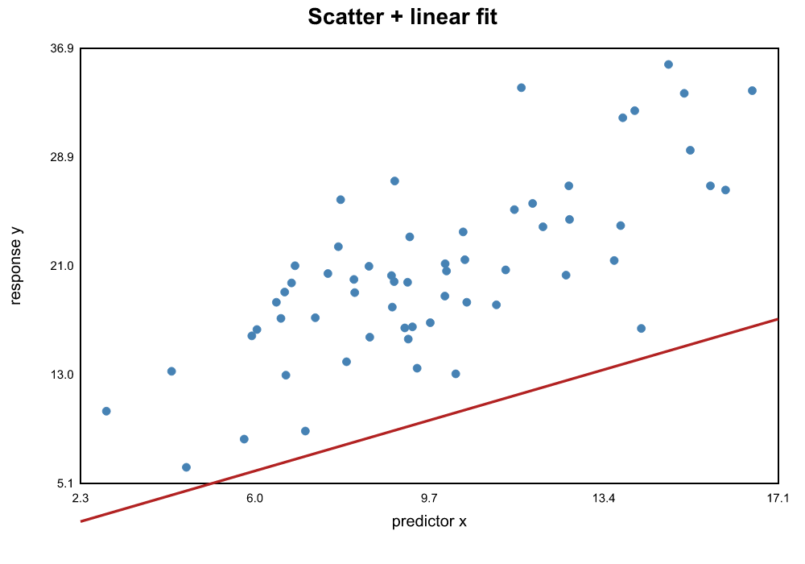
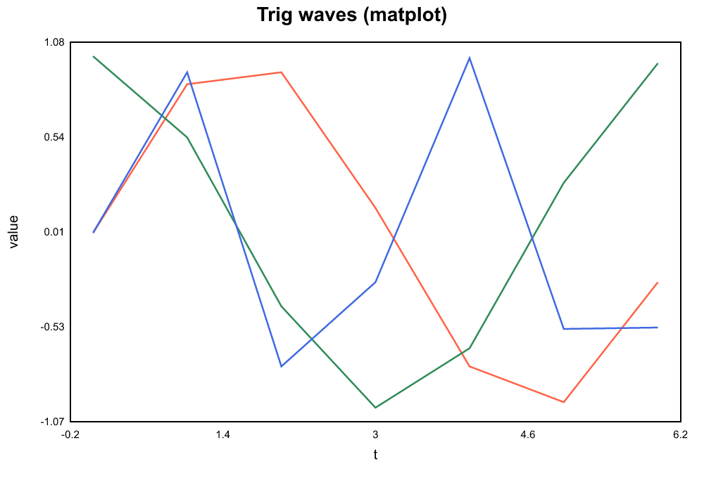
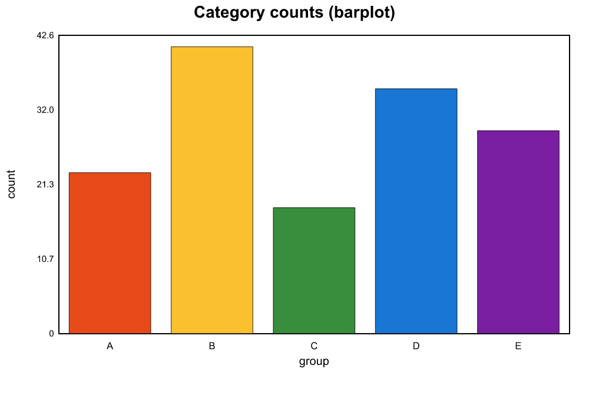
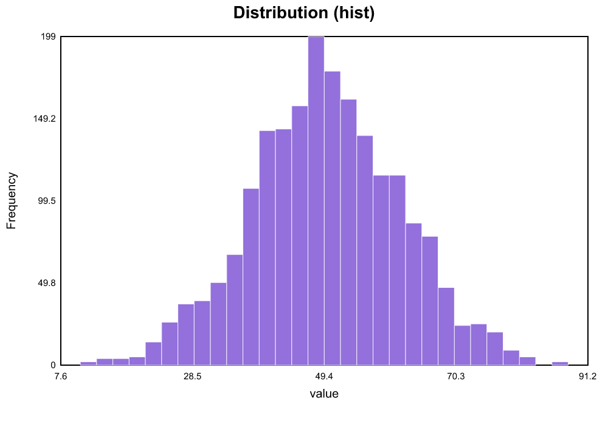
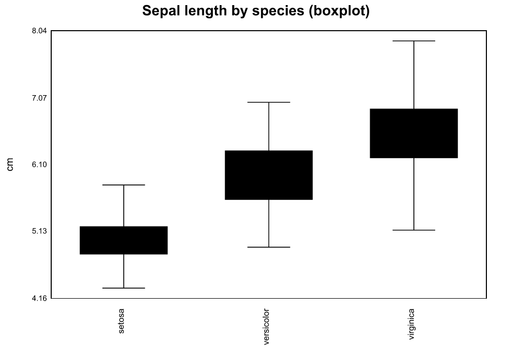
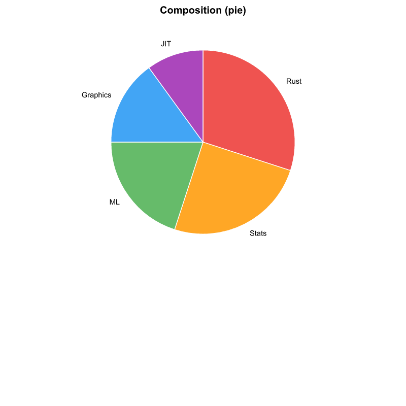

<p align="center">
  
</p>

<h1 align="center">Ardon-R2</h1>

<p align="center"><strong>Inspired by R. Built on Rust.</strong><br>
<em>An AI-Assisted Project.</em><br>
<a href="https://github.com/devendratandle/Ardon-R2/releases/latest"></a></p>

---

**A ground-up rebuild of statistical computing and AI model training in
Rust** — a single small binary that speaks R's language (vectors, data
frames, formulas, `lm`/`glm`/`aov`, S3-style dispatch) **and trains
transformer language models faster than PyTorch** on an ordinary CPU or an
integrated GPU, with identical results. It ships a native desktop GUI,
built-in machine learning, a Cranelift JIT for your own functions, and
automatic parallelism — with **zero C, C++, or Fortran** anywhere in the
stack, no Python, and no packages to install.

> The dominant inefficiencies in today's AI stack are not the math — they're
> the glue between languages, the copies between memory regions, the GIL, the
> dependency mess, and the silent-failure culture. R2 is built to remove them
> at the foundation, not paper over them with another wrapper.

R2 takes R's best ideas and rebuilds them from scratch with modern
performance and Rust-only dependencies. Statistics **agree with R to 15–16
significant figures** (28 differential test cases, see
[PERFORMANCE.md](PERFORMANCE.md)), and LLM training **learns identically to
PyTorch** — the same loss to four decimals at every checkpoint (see
[benchmarks/llm/REPORT.md](benchmarks/llm/REPORT.md)); the whole thing
is one self-contained ~15 MB binary that builds the same on Linux, Windows,
and macOS, x86 and ARM (the Windows installer, carrying CLI + GUI + docs +
samples, is ~9 MB). This README is a **map of the project** — what each folder and file
holds, and where to look next.

## Showcase

> Drop your own GUI / CLI captures into [`screenshots/`](screenshots) — the
> graph images below are generated by [`samples/graph_gallery.r2`](samples/graph_gallery.r2).

| Desktop GUI (`R2Gui`) | Console (`r2`) |
|---|---|
|  |  |

**Graphs** — one example of each plot type (run `r2 samples/graph_gallery.r2`):

| | | |
|---|---|---|
|  |  |  |
|  |  |  |

## Why R2?

| | R | Python (scikit-learn / PyTorch) | R2 |
|---|---|---|---|
| Install size | 200+ MB | 5–8 GB | **~9 MB installer** |
| Setup time | minutes | hours (pip conflicts) | **0 seconds** |
| ML packages needed | 5–10 installs | 3–5 installs | **0 (built-in)** |
| LLM training, 7M-parameter transformer (CPU) | — | 1× (PyTorch + Intel MKL) | **1.5–1.7× faster, identical loss** |
| LLM training on an integrated GPU | — | 1× (PyTorch-DirectML) | **1.3–2.0× faster, identical loss** |
| Matrix multiply (500²) | 1× (reference BLAS) | not measured | **11× faster than R** |
| User loops / library code | 1× (interpreted) | 1× (interpreted) | **6×–40,000× (JIT-compiled)** |
| Numerical accuracy vs R | — | — | **15–16 sig figs (27/27 differential cases)** |
| Cloud required? | No | Often yes | **No** |

## Quick start

```bash
cargo build --release          # needs Rust 1.70+
./target/release/r2            # REPL          (Windows: .\target\release\r2.exe)
./target/release/r2 samples/smoke.r   # run a script
```

Train a small language model from R2's own language (the full walkthrough
is [`samples/llm/train_1m.r2`](samples/llm/train_1m.r2)):

```r
corpus <- paste(rep("ardon r2 trains language models in pure rust. ", 400), collapse = "")
m <- llm.new(dim = 128, layers = 5, heads = 4, kv.heads = 2,
             ffn = 384, ctx = 64, vocab = 512, lr = 0.003, seed = 42)
llm.train(m, corpus, steps = 120, seq = 16, batch = 6, report = 30)
llm.generate(m, "ardon r2", 28)
llm.save(m, "mymodel")        # writes model.json + model.safetensors
```

Prebuilt installers: **Windows** — `installer/Output/R2-Setup-*.exe`;
**Linux** — see [INSTALL_LINUX.md](INSTALL_LINUX.md) (one-shot script for CLI + GUI).

## What's in this repo

| Path | What you'll find |
|------|------------------|
| **[`samples/`](samples)** | Programs you can run to **test R2 on your machine and cross-check against R**. `smoke.r` runs on *both* R and R2 (compare the output); `capabilities.r2` tours the R2-specific features; `graph_gallery.r2` draws the plots above. **Found a mismatch or error? Please [open an issue](https://github.com/devendratandle/Ardon-R2/issues).** |
| **[`PERFORMANCE.md`](PERFORMANCE.md)** | The R-vs-R2 benchmarks + accuracy. Accuracy **matches CRAN R (27/27 differential cases)**; at parity with R on most C internals, 11–25× on matrix multiply, 2–6× on linear algebra, and **6×–40,000× faster on user loops and library code** the JIT compiles. Includes a CPU-vs-integrated-GPU table (from v0.3.8). Re-timed 2026-09-28. |
| **[`benchmarks/llm/REPORT.md`](benchmarks/llm/REPORT.md)** | **R2 vs PyTorch and JAX on LLM training** — the single source for those numbers. A 7.24M-parameter model trained on TinyStories trains **1.5–1.66× faster than PyTorch 2.13+MKL** (1.40–1.63× at 40M parameters) and **learns identically** (same loss to four decimals at every checkpoint, from shared initial weights; forward 1.48× and backward 1.41× faster phase by phase). BPE tokenization is **~11× faster than HuggingFace `tokenizers`**. Includes what was tried and measured *worse*, so it isn't retried. |
| **[`benchmarks/`](benchmarks)** | The runnable benchmark harness (tuned parallel `.R`/`.r2` files) behind PERFORMANCE.md — reproduce the numbers yourself. |
| **[`FUNCTIONS.md`](FUNCTIONS.md)** | Complete reference for the 400+ built-in functions. |
| **[`CHANGELOG.md`](CHANGELOG.md)** | Per-version history — what functions were added and what problems were fixed, release by release. |
| **[`docs/ARCHITECTURE.md`](docs/ARCHITECTURE.md)** | The compiler / runtime / IR / JIT / scheduler design — current state **and** the forward plan. Start here for *how it works*. |
| **[`docs/`](docs)** | `KNOWN_LIMITATIONS.md`, `LIBRARY_ARCHITECTURE.md`, and design notes (GUI framework, mobile port, kernel dispatch). |
| **[`VISION.md`](VISION.md)** | Why R2 exists — the Green-AI / efficiency thesis. |
| **[`INSTALL_LINUX.md`](INSTALL_LINUX.md)** | Linux install guide (CLI + GUI), prebuilt or from source. |
| **[`screenshots/`](screenshots)** | Graph gallery output + your GUI/CLI screenshots. |
| **[`crates/`](crates)** | The source — 29 focused crates (`r2-parser` → `r2-types` → `r2-engine` → domain crates → `r2-kernel` → `r2-arrow`). Split small, on purpose, so logic is easy to locate. |

## Highlights

- **462 built-in functions and operators**, every one with `?help` — stats, ML, AI training, data manipulation, graphics, time series — no packages to install.
- **AI model training, faster than PyTorch** — BPE tokenizer, autograd tape, fused attention and an Adam trainer, all in Rust with no C and no Python, driven from R2 code (`llm.new`, `llm.train`, `llm.generate`, `llm.save`). A 7.24M-parameter transformer trains **1.5–1.7× faster than PyTorch + MKL** (1.40–1.63× at 40M parameters; 1.34–1.37× on an Intel CPU, MKL's home ground) and learns identically. A whole-step **GPU trainer** on any Vulkan/DirectX/Metal GPU via wgpu runs **1.3–2.0× faster than PyTorch-DirectML** on an integrated GPU. See [`benchmarks/llm/REPORT.md`](benchmarks/llm/REPORT.md).
- **Statistics**: `lm`/`glm`/`aov` (incl. repeated-measures `Error()`), `t.test`/`cor.test`/`shapiro.test`, Hotelling's T², MANOVA (Wilks/Pillai/Hotelling-Lawley/Roy).
- **Machine learning, built in**: decision tree, random forest, gradient boosting, KNN, naive Bayes, PCA, K-means, cross-validation.
- **Graphics**: in-memory device, full `par()` multi-panel layouts, scatter/line/bar/hist/box/pie, PNG/SVG/PDF output, and a live browser plot viewer (`dev.view()`).
- **JIT-compiled user functions** — pure-arithmetic closures compile to native code via Cranelift; multi-op math fuses into one loop.
- **Pure-Rust math kernel** — one blocked/packed GEMM with AVX2 (and AVX-512) micro-kernels chosen at *runtime* (one binary runs everywhere), behind both LLM training (f32) and `%*%` (f64, at Intel MKL's speed); LU, Cholesky, QR, eigen and SVD built on it run 2–6× faster than R's reference LAPACK; distributions checked against R to 1e-13; automatic serial/Rayon parallelism.

Want to see it run rather than read code? `r2 samples/smoke.r` and
`r2 samples/capabilities.r2`.

## Contributing

Good first issues, grouped by background:

- **If you know R well** — port a missing statistical test (Mann-Whitney U, Kruskal-Wallis, Friedman); port a CRAN dataset; write a help topic; or run `samples/smoke.r` on R and R2 and file any behaviour mismatch.
- **If you know Rust well** — extend the JIT to a new pattern; add a builtin to the parallel apply path; add a new SVG plot type; or improve the linear-algebra kernels.

Open the issue first so we can scope it together. See
[CONTRIBUTING.md](CONTRIBUTING.md) for the workflow and [CLA.md](CLA.md) for
the contributor agreement.

## License

AGPL v3 — Created by Devendra Tandale. An AI-assisted project.
